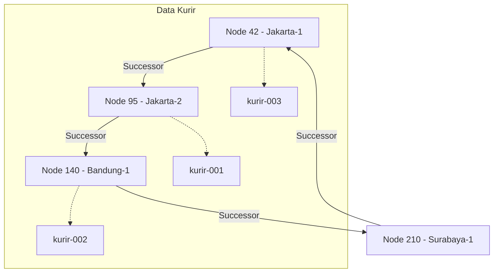

# Laporan Tugas 6 — Penamaan & Resolusi Lokasi (Chord DHT)
**Kelompok:**   
**Anggota:**  
1. Dwi Surya Andika (103072400003) Penelusuran Manual `lookup()` untuk Salah Satu Contoh Kurir 
2. Krisna Wahyudi Pratama (103072400048) Diagram Ring Topology (Mermaid)
3. Rizqi Rahmatullah (103072400018) Analisis: Kenapa DHT/Chord Lebih Cocok Dibanding Flat Naming & DNS Konvensional?
## 1. Analisis: Kenapa DHT/Chord Lebih Cocok Dibanding Flat Naming & DNS Konvensional?
* **Dibanding Flat Naming Sederhana (Tabel Pusat):** Flat naming menggunakan basis data pusat atau direktori tunggal untuk memetakan ID Kurir ke IP. Jika server pusat down (*single point of failure*), seluruh sistem pelacakan kurir lumpuh. Chord DHT menggunakan struktur terdesentralisasi berbasis *consistent hashing* tanpa server pusat, sehingga tahan terhadap kegagalan node.
* **Dibanding DNS Konvensional:** DNS dirancang untuk entitas yang relatif statis dengan masa *Time-To-Live* (TTL) cache yang lama. Alamat IP kurir FoodGo sangat dinamis (sering berpindah jaringan seluler/Wi-Fi). Mengandalkan DNS konvensional akan menyebabkan latensi tinggi karena propagasi pembaruan record DNS, sedangkan Chord DHT mendistribusikan pembaruan secara langsung dan cepat di dalam ring identifier.

## 2. Penelusuran Manual `lookup()` untuk Salah Satu Contoh Kurir
* **Contoh:** `"kurir-001"`
* **Langkah 1 (Hashing):** Fungsi `hash_id("kurir-001")` menghasilkan nilai hash integer di ruang $0 \dots 255$ (misal hasil SHA-1 modulo 256 menghasilkan angka `74`).
* **Langkah 2 (Pencarian Successor):** Algoritma `find_successor(74)` memindai seluruh `node_id` aktif di dalam `self.nodes`.
* **Langkah 3 (Penentuan Node):** Dicari node dengan ID terkecil yang nilainya $\ge 74$. Jika node terdekat yang lebih besar adalah `95`, maka `Node 95` ditetapkan sebagai penanggung jawab dan mengembalikan IP kurir terkini (`192.168.1.10`). Jika tidak ada nilai yang $\ge 74$, sistem melakukan *wrap-around* ke node terkecil di ring.

## 3. Diagram Ring Topology (Mermaid)

4. Perilaku Saat Node Keluar (Leave)
Ketika sebuah node keluar dari ring (misal node-jakarta-1), seluruh kunci data (mapping) yang sebelumnya dikelola oleh node tersebut secara otomatis dialihkan dan diambil alih oleh node successor terdekat berikutnya berdasarkan aturan struktur ring melingkar Chord, sehingga data pemetaan ID kurir tetap aman dan dapat diakses melalui node lain yang masih aktif.