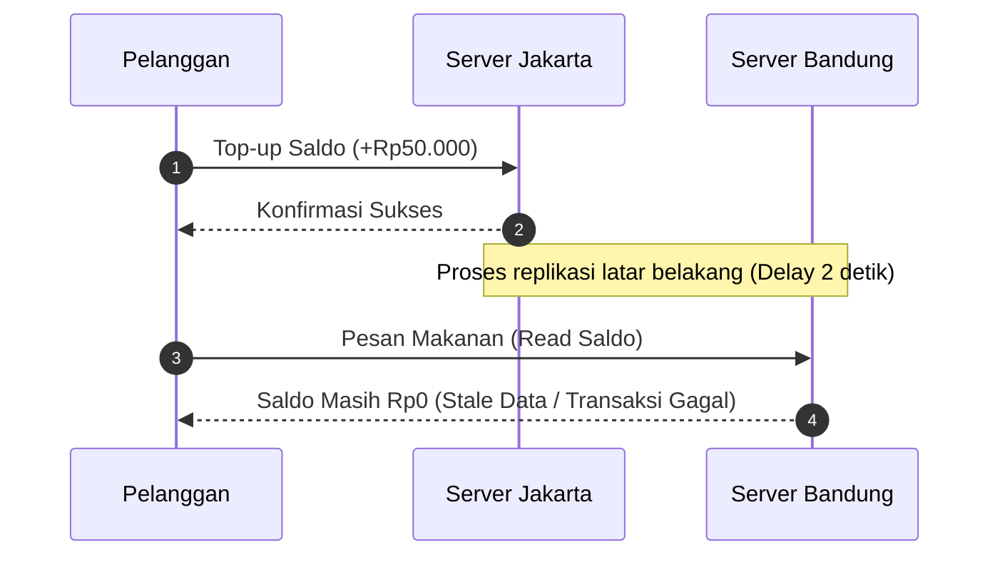

# Laporan Tugas 7 — Konsistensi Data (Data-Centric & Client-Centric)

**Kelompok:**  
**Anggota:**

1. Dwi Surya Andika (103072400003) Analisis Model Konsistensi pada Kasus Saldo E-Wallet FoodGo
2. Krisna Wahyudi Pratama (103072400048) Sequence Diagram (Mermaid)
3. Rizqi Rahmatullah (103072400018) Analisis: Skenario Tambahan

## 1. Analisis Model Konsistensi pada Kasus Saldo E-Wallet FoodGo

Keterbatasan Eventual Consistency
Eventual consistency hanya menjamin data akan sinkron di seluruh server pada akhirnya. Pada layanan finansial atau e-wallet seperti FoodGo, jeda sinkronisasi data ini bisa berakibat buruk pada bisnis. Pelanggan bisa mendapati transaksi pesanannya ditolak padahal baru saja mengisi saldo, yang tentunya sangat mengganggu pengalaman pengguna.

Pendekatan yang Dibutuhkan
Solusinya adalah menerapkan Client-Centric Consistency, khususnya prinsip Read-Your-Writes. Dengan metode ini, setelah pelanggan melakukan aksi seperti top-up di server utama (Jakarta), sistem menjamin pembacaan data berikutnya oleh pelanggan tersebut—bahkan saat ditangani server regional lain (Bandung)—akan langsung menampilkan nilai pembaruan paling aktual.

## 2. Skenario Tambahan (Diluar Studi Kasus Utama)

- **Kasus:** Aplikasi Ojek Online (Pemesanan Perjalanan & Update Titik Jemput).
- **Model Konsistensi yang Tepat:** _Monotonic Reads_. Jika penumpang mengubah titik penjemputan atau melihat posisi driver di peta dari satu layar ke layar lain, sistem harus menjamin bahwa penumpang tidak melihat versi data yang "mundur ke belakang" (menampilkan posisi driver yang lebih lama dari yang baru saja diterima).

## 3. Sequence Diagram (Mermaid)

### A. Skenario Tanpa Jaminan Konsistensi (Terjadi Bug Inconsistent Read)

